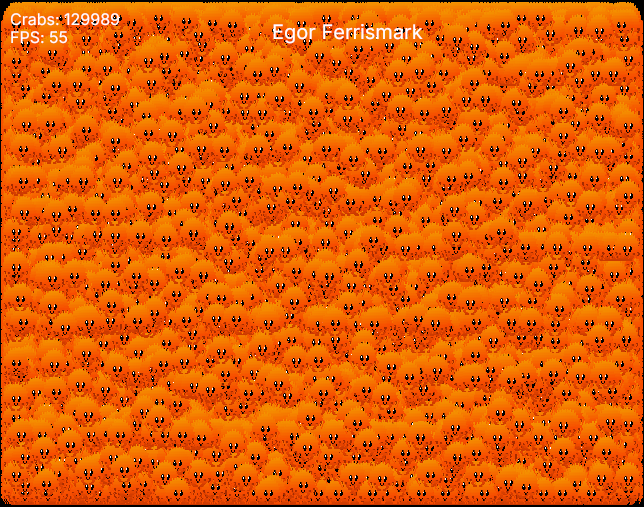

# Egor Ferrismark Demo

 (the little dude seen below)

A simple stress test for **egor** with Ferris the crab (or a few)

> 129,989 crabs at 55 FPS

## Performance

The results seen here were produced (with this demo) from an optimized release build with a Ryzen 5 1600 and a Radeon Pro WX 2100 using the Vulkan backend on Wayland/Arch Linux. Each crab is updated and rendered individually, without GPU instancing. On a CPU rasterizer (llvmpipe) the same demo holds 27 FPS with 10,000 crabs.

## Spawning Crabs

Click to spawn 9,999 crabs at a time. Repeat to see how many **egor** can handle
